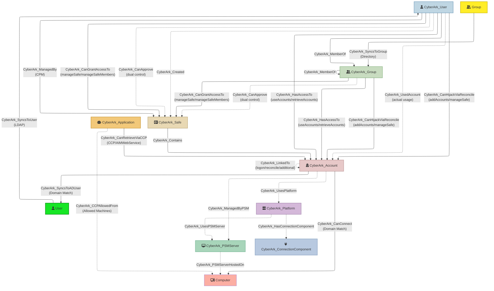

# Output format

The exported file, node IDs and node properties, and how the data flows from PVWA to BloodHound.

[← Back to the README](../README.md)

## Deterministic Output

Exports are **deterministic**: nodes are written sorted by `id`, edges by `(kind, start, end, properties)`, and list-valued properties such as `permissions` are sorted. Two collections of the same unchanged environment produce byte-identical exports, so they can be diffed across runs to spot real changes. A graph rebuilt with `--from-raw` is byte-identical to the export of the original run.

## Node Properties

### CyberArk_Instance Properties
- **Identity**: `name`, `pvwaTag` (the 4-character PVWA tag derived from `--pvwa`)
- The environment root node. One `CyberArk_Instance` node is emitted per run and is linked to the bounded set of top-level configuration objects (safes, platforms, PSM servers, connection components) via `CyberArk_InstanceContains`. Users and groups are deliberately excluded — in LDAP/AD-synced vaults they can number in the millions, and a direct fan-out would balloon the export; they attach to the graph through their membership and safe-permission edges instead. Accounts are reached transitively through their safe (`CyberArk_Instance` → `CyberArk_Safe` → `CyberArk_Contains` → `CyberArk_Account`).

### CyberArk_User Properties
- **Identity**: `userId`, `name`, `userType`, `source`, `isLDAPSynced`
- **Status**: `enabled`, `suspended`, `componentUser`
- **Authentication**: `allowedAuthenticationMethods`, `vaultAuthorization`
- **Directory**: `distinguishedName`, `location`, `authorizedInterfaces`
- **Personal Details**: `firstName`, `lastName`, `email`, `businessEmail`, `businessPhone`, `mobilePhone`, `title`, `organization`, `department`, `profession`, `address` (street, city, state, zip, country)
- **Memberships**: `groupsMembership` (list of group names)
- **Permissions**: `safePermissions` (JSON array with safeName, permissions, hasDirectAccess, canGrantAccess; time-limited memberships also carry `membershipExpirationDate`, and expired ones `membershipExpired: true` — expired memberships create no edges)

### CyberArk_Group Properties
- **Identity**: `groupId`, `name`, `groupType`, `isDirectorySynced`
- **Directory**: `directory`, `distinguishedName`, `location`
- **Metadata**: `description`, `memberCount`
- **Members**: `members` (list of usernames)
- **Permissions**: `safePermissions` (JSON array with safe access details, including `membershipExpirationDate` / `membershipExpired` as for users)

`CyberArk_MemberOf` edges come from both each user's `groupsMembership` (edge property `source: "userDetails"`) and each group's member list (`source: "groupMembers"`); a membership reported by both produces one edge.

### CyberArk_Safe Properties
- **Identity**: `safeName`, `safeUrlId`, `safeNumber`
- **Metadata**: `description`, `location`, `creator`
- **CPM**: `managingCPM`, `olacEnabled`
- **Retention**: `numberOfVersionsRetention`, `numberOfDaysRetention`, `autoPurgeEnabled`
- **Timestamps**: `creationTime`, `lastModificationTime`
- **Settings**: `isExpiredMembershipEnable`

### CyberArk_Account Properties
- **Identity**: `accountId`, `userName`, `platformId`, `address`
- **BloodHound name**: `name` (set to `userName` to avoid collisions with AD user names in OpenGraph matching)
- **Safe**: `safeName`, `safeUrlId`
- **Status**: `status`, `enabled`, `secretType`
- **Management**: `automaticManagementEnabled`, `manualManagementReason`
- **Dual control**: `dualControlWithoutApprovers` (set to `true` when the account's platform requires dual-control approval and no member of its safe can confirm requests) — used by the `DUAL_CONTROL_NO_APPROVERS` finding
- **Timestamps**: `createdTime`, `lastModifiedTime`, `lastVerifiedTime`, `lastReconciledTime`, `categoryModificationTime`
- **CPM**: `lastModifiedBy`
- **PSM posture** (set when platform data is available): `managedByPSM` (account is brokered by a PSM server), `sessionMonitoringEnabled`, `sessionRecordingEnabled` — used by the `PSM_BREAKOUT_EXPOSURE` finding
- **Extended**: `platformAccountProperties` (JSON), `secretManagement` (JSON)

### CyberArk_Platform Properties (requires `--include-platforms`)
- **Identity**: `platformId`, `name`
- **Configuration**: `systemType`, `active`, `platformBaseID`, `platformType`
- **Metadata**: `description`, `allowedSafes`
- **Properties**: `requiredProperties`, `optionalProperties` (field definitions)
- **Linked Accounts**: `linkedAccountTypes` (e.g., LogonAccount, ReconcileAccount)
- **Connection Components**: `connectionComponents` (list of enabled PSM connector IDs, e.g., `["PSM-RDP", "PSM-SSH"]`)
- **Session Management**: `psmServerID`, `requirePrivilegedSessionMonitoringAndIsolation`, `recordAndSaveSessionActivity`
- **Credentials Management**: `allowManualChange`, `performPeriodicChange`, `requirePasswordChangeEveryXDays`, `allowManualVerification`, `performPeriodicVerification`, `requirePasswordVerificationEveryXDays`, `allowManualReconciliation`, `automaticReconcileWhenUnsynched`
- **Privileged Access Workflows**: `requireDualControlPasswordAccessApproval`, `enforceCheckinCheckoutExclusiveAccess`, `enforceOnetimePasswordAccess`, `requireUsersToSpecifyReasonForAccess`
- **Master Policy Exception Flags**: `dualControlIsException`, `exclusiveAccessIsException`, `otpIsException`, `reasonForAccessIsException`, `sessionMonitoringIsException`, `sessionRecordingIsException`, `verificationFrequencyIsException`, `changeFrequencyIsException` — `true` when the platform's setting deviates from the Master Policy default
- **Data Source**: `dataSource` — set to `"targets-fallback"` when the node was created from `/API/Platforms/Targets` instead of `/API/Platforms/` (see fallback behavior below)

**Platform data fallback:** When `GET /API/Platforms/` fails (e.g., HTTP 500 due to corrupted platform definitions), CyberArkHound creates platform nodes from the `GET /API/Platforms/Targets` response instead. These fallback nodes contain most security-relevant properties (workflows, credentials management, PSM server, exception flags) but lack `description`, `platformBaseID`, `platformType`, `requiredProperties`, `optionalProperties`, and `linkedAccountTypes`. Fallback nodes are tagged with `dataSource: "targets-fallback"`.

### CyberArk_PSMServer Properties (requires `--include-psm`)
- **Identity**: `psmServerId` (e.g., `"PSMServer_7ec0ecb"`)
- **Configuration**: `name` (e.g., `"PSM Server CYB-IS-12345"`), `address` (e.g., `"10.10.10.20"`)

### CyberArk_ConnectionComponent Properties (requires `--include-psm`)
- **Identity**: `connectorId` (e.g., `"PSM-RDP"`, `"PSM-SSH"`)
- **Display**: `displayName` (e.g., `"RDP"`, `"SSH"`)

### CyberArk_Application Properties (requires `--include-applications`)
- **Identity**: `appId`, `name` (the AppID), `description`, `location`
- **Status**: `disabled`
- **Business Owner**: `businessOwnerName`, `businessOwnerEmail`, `businessOwnerPhone`
- **Authentication restrictions**: `allowedMachines` (list of permitted IPs/hosts), `authMethods` (distinct AuthType values configured), `hasMachineRestriction`, `hasOSUserRestriction`, `hasPathRestriction`, `hasHashRestriction`, `hasCertificateRestriction`
- **Risk flags**:
  - `isUnrestricted` — `true` when the AppID has **no** authentication restriction of any kind; possession of the AppID alone is sufficient to retrieve its credentials via CCP
  - `isDefaultCCPApp` — `true` for the default `AIMWebService` AppID, which usually has access to all safes
  - `authenticationsUnknown` — present (`true`) when the AppID's authentication restrictions could not be read; such an AppID is not assessed as restricted or unrestricted

> **Note on Platform risk flag:** `--include-platforms` also adds `allowedSafesIsWildcard` to `CyberArk_Platform` nodes — `true` when the platform's `AllowedSafes` is `.*` (or otherwise matches any safe), the over-permissive setting called out in [Nigmatullin's SO-CON 2026 talk](ccp-tradecraft.md#tradecraft-reference).

## Output
The resulting JSON structure follows BloodHound OpenGraph schema:

Note: CyberArk node `id` values are namespaced with a PVWA tag (e.g., `causer-jdoe-APVA`) so that several PVWA instances can be ingested into one BloodHound. By default the tag is 4 characters derived from the first two labels of the `--pvwa` host name, so different vaults can end up with the same tag — for example `pvwa-eu.corp.com` and `pvwa-us.corp.com` (both `PVCO`), or any two PVWAs addressed by IP. Vaults sharing a tag would have their nodes merged in BloodHound. When importing more than one vault, give each a distinct `--pvwa-tag` (e.g. `--pvwa-tag PROD-EU`). The tag also applies with `--from-raw`, so an existing raw collection can be re-tagged without collecting again; changing a vault's tag changes all of its node IDs, so re-import it rather than mixing old and new tags.

**Placeholder nodes.** Some edges point at objects the collection references but never receives itself: a safe member or safe creator missing from the user list, a group named in a user's memberships, a linked account in a safe the collector cannot list, a user who appears only in activity logs. For each of these CyberArkHound emits a node of the right kind with the referenced name and `placeholder: true`, so the object is named, typed and found by kind-based queries. Without it, BloodHound would create an anonymous node with no kind for the edge's endpoint. Placeholders carry no other properties and are ignored by the security findings; `MATCH (n:CyberArkBase {placeholder: true}) RETURN n` lists them.
```json
{
  "metadata": {
    "source_kind": "CyberArkBase"
  },
  "graph": {
    "nodes": [
      {
        "id": "causer-jdoe-APVA",
        "kinds": ["CyberArk_User", "CyberArkBase"],
        "properties": {
          "name": "jdoe",
          "isLDAPSynced": true,
          "vaultAuthorization": "[\"Audit Users\", \"Safe Managers\"]",
          "safePermissions": "[{\"safeName\":\"Production\",\"permissions\":[\"useAccounts\",\"retrieveAccounts\"],\"hasDirectAccess\":true}]",
          "email": "jdoe@corp.com",
          "department": "IT Security"
        }
      },
      {
        "id": "caaccount-12345-APVA",
        "kinds": ["CyberArk_Account", "CyberArkBase"],
        "properties": {
          "name": "prod-db-admin",
          "platformId": "WinServerLocal",
          "address": "prod-sql-01.corp.com",
          "safeName": "Production",
          "automaticManagementEnabled": true
        }
      }
    ],
    "edges": [
      {
        "kind": "CyberArk_HasAccessTo",
        "start": "causer-jdoe-APVA",
        "end": "caaccount-12345-APVA",
        "properties": {
          "matchedPermissionNames": ["useAccounts", "retrieveAccounts"],
          "via": "casafe-Production-APVA",
          "viaSafeName": "Production"
        }
      }
    ]
  }
}
```

**External edges** (AD sync relationships) are included in the same structure with `match_by` metadata for cross-domain correlation.
```json
{
	"metadata": { "source_kind": "CyberArkBase" },
	"graph": {
		"nodes": [ { "id": "...", "kinds": ["CyberArk_User"], "properties": {"name": "..."} } ],
		"edges": [ { "kind": "CyberArk_HasAccessTo", "start": {"value": "...", "match_by": "id"}, "end": {"value": "...", "match_by": "id"} } ]
	}
}
```
External edges (CyberArk_SyncsToUser / CyberArk_SyncsToGroup / CyberArk_SyncsToADUser / CyberArk_CanConnect / CyberArk_PSMServerHostedOn / CyberArk_CCPAllowedFrom) are included with `match_by` set to `name` where appropriate.

## Data Flow Diagram
High-level relationship visualization between CyberArk entities and inferred external AD objects:



**Legend** (matches how BloodHound draws these edges in Explore):
- **Solid lines** (→): **traversable** edges, which BloodHound uses for pathfinding and Attack Path analysis. These are membership, credential access, safe escalation, CPM management, safe containment, and the AD sync and credential bridges.
- **Dashed lines** (⇢): **non-traversable** edges. They are context only and never part of a computed path: dual-control approval, historical usage, linked-account dependencies, safe creator, platform and PSM configuration, and the CCP allowed-machine and PSM host mappings.
